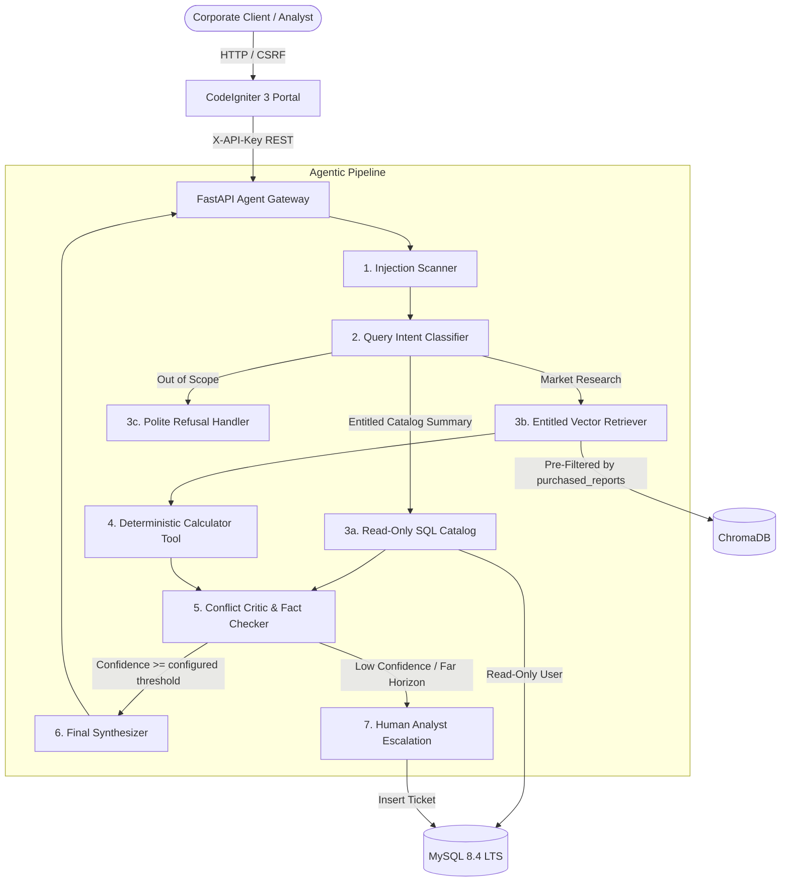

# Project Atlas: Report Copilot

Project Atlas is a report intelligence application built with a CodeIgniter 3 portal, FastAPI, MySQL, ChromaDB retrieval, and grounded LLM answers. The default Docker Compose configuration runs without assignment fixtures. The fictional Appendix A dataset is isolated in `docker-compose.demo.yml` and must only be used for assessment testing.

The application code supports report ingestion, report-level client entitlements, citations, calculations, source-conflict handling, prompt-injection defense, read-only SQL summaries, analyst escalation, and feedback. It is not preloaded with real customer reports or connected to an organization's identity portal. Those integrations and authorized data must be configured before real users can get real market answers.

## Assessment demo: quickest way to run

The GitHub link opens the source and instructions; it does not host the running app. For the PDF assessment demo, use the isolated fictional dataset and demo configuration below. A reviewer needs Docker Desktop with its engine running. The demo client selector is only for assessment; it is not organization authentication or real licensed research.

1. Clone or download this repository and open its folder in VS Code.
2. Copy `.env.example` to `.env`. Generate unique values for each `CHANGE_ME` secret; do not commit `.env`.
3. For answers without paid API credits, install Ollama on the host and download a model supported by your computer. Set `LLM_PROVIDER=ollama` and `LLM_MODEL` to the exact model name shown by `ollama list` in `.env`. Keep `OLLAMA_BASE_URL=http://host.docker.internal:11434`. The model must be running locally; Ollama avoids provider API charges but uses your computer's disk, memory, and processing power.
4. In the VS Code terminal, from the repository folder, run:

   ```powershell
   docker compose -p atlas-demo -f docker-compose.yml -f docker-compose.demo.yml up --build
   ```

5. Wait until the services report healthy, then open [http://localhost:8080/index.php/copilot](http://localhost:8080/index.php/copilot). The demo client selector and eight quick scenarios are visible in the portal. Stop the stack with `Ctrl+C`; in another terminal run `docker compose -p atlas-demo -f docker-compose.yml -f docker-compose.demo.yml down` if you want to remove the containers while keeping database data.

If the repo page itself will not open, check the URL and GitHub access: a private repo requires the reviewer to be invited with sufficient read access. If the repo opens but the demo does not start, ask them to share the exact Docker error and confirm Docker Desktop says **Engine running**. If the app starts but answers fail, check that the chosen Ollama model is downloaded and running, and that `.env` has the matching model name. Never send `.env` or secret values to reviewers.

## Production / organization integration

The default Compose configuration below is for production-style integration, not the assessment fixture demo. It intentionally excludes fictional data and requires a trusted organization login session. Use the assessment section above to demonstrate the PDF assignment.

## Run the production configuration on Windows

### Requirements
- Docker Desktop installed, with the Docker Engine running.
- PowerShell terminal opened in this project folder.
- A local `.env` copied from `.env.example`, with separate random secrets configured. Keep `.env` private; it is ignored by Git.
- A model provider: OpenAI-compatible inference with a funded key, or a local Ollama installation (no provider API charge).
- Your authenticated CodeIgniter host must set the trusted client session field configured in `.env`; the standalone project intentionally rejects unauthenticated users.
- Put only authorized reports in `production_reports/`; no fictional assignment corpus is loaded by the default configuration.

### Start

From the VS Code terminal, first move into the project folder if needed:

```powershell
cd "C:\Users\<your-user>\OneDrive\Documents\Projects\Project Atlas"
```

Start the application without assignment fixtures:

```powershell
docker compose up --build
```

When containers start, the portal is at [http://127.0.0.1:8080/index.php/copilot](http://127.0.0.1:8080/index.php/copilot) and API health is at [http://127.0.0.1:8000/health](http://127.0.0.1:8000/health). An empty production corpus is an expected onboarding state; the API remains available and reports that no authorized documents are indexed. The chat route requires a client session supplied by the integrated organization portal.

For local inference without API credits, install Ollama on the Windows host, download a model compatible with your machine, and set `LLM_PROVIDER=ollama`, `LLM_MODEL` to the name shown by `ollama list`, and `OLLAMA_BASE_URL=http://host.docker.internal:11434` in `.env`. OpenAI key and token-price values are not needed in Ollama mode. Model downloads use local disk/RAM and answer speed depends on the computer.

To stop the foreground stack, press `Ctrl+C`; to remove containers while retaining named database volumes, run:

```powershell
docker compose down
```

The assignment fixtures are available only when intentionally starting the separate assessment configuration:

```powershell
docker compose -p atlas-demo -f docker-compose.yml -f docker-compose.demo.yml up --build
```

## Assessment scope and known gaps

The implementation covers the PDF's main technical areas: report ingestion and metadata, client-scoped retrieval, query routing, deterministic calculations, conflict handling, escalation, API endpoints, a CodeIgniter chat page, SQL guardrails, Docker packaging, and a 25-question evaluation harness. The evaluation must be rerun against the current code before reporting a final score.

Known limitations:
- The included market reports and client data are synthetic assignment fixtures, not licensed reports.
- The latest reported evaluation was 19/25. Five factual lookups failed because the provider account had no available credits; a fresh run requires an enabled provider balance or a configured local model.
- The report-count test had a response-wording mismatch. Its assertion has been updated, but the full harness has not yet been rerun to confirm the corrected score.
- The demo client selector is for assessment use only. A real deployment still needs the organization's authenticated client identity and entitlement provisioning.
- The PDF asks for a 3-5 minute demo video. It is a separate submission item and is not included in this repository's runnable application.
- Do not describe this assessment setup as production-ready: licensed corpus, organization authentication, TLS deployment, provider billing, and a complete fresh evaluation remain deployment/submission responsibilities.

---

## Organization integration and production deployment requirements

### Required before deployment
- Docker and Docker Compose.
- A supported model provider: a funded OpenAI-compatible API key plus current token prices, or a locally running Ollama model.
- Separate random secrets for client traffic (`API_KEY`) and operations (`OPS_API_KEY`).
- For hosted inference, the current input and output token prices for that model, configured in `.env` so the service can record usage costs accurately. Local Ollama requests are logged at zero provider cost.
- A response token cap (`LLM_MAX_OUTPUT_TOKENS`, default 800; maximum 4096).
- Six or more market reports that your organization is licensed to process, prepared as Markdown or PDF with the metadata format in `production_reports/README.md`.
- An authenticated CodeIgniter portal that sets the configured `ATLAS_CLIENT_SESSION_FIELD` session value after resolving the signed-in user's organization. The default field is `authenticated_client_id`; the sample client selector is available only in demo mode.
- A TLS reverse proxy in front of the portal. The API is loopback-only, and MySQL is reachable only on Docker's private network.

### Configure and start
```bash
# Copy the environment configuration and replace every CHANGE_ME value
cp .env.example .env

# For no-credit local inference, set LLM_PROVIDER=ollama and configure
# OLLAMA_BASE_URL and LLM_MODEL as described above. Otherwise keep openai
# and configure OPENAI_API_KEY and model token prices.

# Put licensed report Markdown files under production_reports/ and provision
# authenticated client rows and report entitlements in MySQL.
# Set REPORTS_HOST_DIR in .env to mount a different host folder when needed.

# Start MySQL, the FastAPI service, and the CodeIgniter portal
docker compose up --build
```

The first MySQL start creates the schema and application users. It does **not** load the fictional assignment clients or figures. Add or update report files, then invoke the authenticated `POST /ingest` endpoint to register report metadata and index their page chunks. The new report IDs must also be added to each client's `purchased_reports` record through the trusted client provisioning process.

Example ingestion call from the deployment host:

```bash
# Export OPS_API_KEY from your local .env without committing or sharing it.
curl -X POST http://127.0.0.1:8000/ingest -H "X-Ops-Key: $OPS_API_KEY"
```

Use the separate `X-Ops-Key` for report ingestion and escalation review. The portal receives only `API_KEY`, which is limited to chat and feedback.

Before production use, set `ATLAS_DEMO_MODE=false`, `DATASET_LABEL=production`, and `COOKIE_SECURE=true` when HTTPS is terminated in front of the portal. Leave `LOAD_ASSIGNMENT_FIXTURES=false`. Existing CI3 authentication must populate the session field named by `ATLAS_CLIENT_SESSION_FIELD`; this repository does not contain the organization's login/identity system. Never make the demo client switcher available to real clients.

### Access Endpoints
- **CodeIgniter 3 Chat Portal**: [http://localhost:8080](http://localhost:8080) (loopback only; place behind TLS proxy for deployment)
- **FastAPI Interactive Docs**: [http://localhost:8000/docs](http://localhost:8000/docs) (loopback only)
- **Health Check**: [http://localhost:8000/health](http://localhost:8000/health)

---

## Local Python development

For assignment demonstration only, you can opt into the fictional fixture dataset. Keep this mode isolated from production:

```bash
# Copy .env.example to .env and replace every CHANGE_ME value. Configure either
# a funded hosted provider or local Ollama as described in the assessment steps.
docker compose -p atlas-demo -f docker-compose.yml -f docker-compose.demo.yml up --build
```

For direct Python development, install `backend/requirements.txt`, set `ALLOW_SQLITE_FALLBACK=true` only when MySQL is unavailable, and point `REPORTS_DIR` at your authorized corpus. The default report folder is the empty `production_reports/` directory. Fictional data under `data/reports` is used only by the explicit demo compose overlay. For the assessment demo, a funded hosted provider is optional: local Ollama is supported. Follow the assessment quick-start above and configure `LLM_PROVIDER=ollama` with a model that is already installed and running on the host.

The assignment reports and sample companies are fictional and must never be treated as real market research or customer records. The default production configuration does not load them. Existing database volumes from an earlier demo should be reviewed before reuse; MySQL initialization scripts run only when creating a fresh data volume.

---

## 3. Architecture Overview



---

## 4. Design Decisions & Trade-Offs

### 1. Pre-LLM Entitlement Filtering vs Post-Retrieval Prompt Filtering
- **Decision**: Filter chunks strictly at the vector database query layer (`where={"report_id": {"$in": allowed_reports}}`).
- **Rationale**: Relying on the LLM to ignore unpurchased text in prompt context frequently leaks figures via indirect prompt injection or hallucination. Pre-filtering ensures unpurchased text physically never reaches the model context.
- **Trade-off**: Requires an additional metadata lookup in MySQL before vector queries, adding ~2ms of latency.

### 2. Deterministic Math Engine vs LLM Calculation
- **Decision**: Execute CAGR and regional projections via a dedicated Python calculator tool.
- **Rationale**: Language models frequently make arithmetic rounding errors over multi-year compounding formulas ($V_{end} = V_{start} \times (1 + r)^n$). Our calculator enforces deterministic math, outputs exact formulas, documents assumptions, and labels the result as a `derived_estimate`.
- **Trade-off**: Requires query intent classification to map requests to the calculator tool.

### 3. Preserving Conflicts vs Averaging
- **Decision**: When two sources report different values (e.g. R-101 at $4.21B vs R-102 at $3.87B for 2024), both values are displayed alongside their scope notes in a dedicated `conflicts[]` JSON structure.
- **Rationale**: In professional syndicated research, averaging two distinct methodology scopes is an unacceptable analytical error.
- **Trade-off**: Requires custom UI cards in the portal to display multi-source discrepancies cleanly.

### 4. Dual User MySQL Security Model
- **Decision**: Configure two distinct database users:
  1. `atlas_app`: Limited to report metadata ingest, client ID/entitlement reads, escalation writes/operations reads, chat logging, feedback updates, and security-audit inserts.
  2. `atlas_readonly`: `SELECT` access on `reports` and `market_metrics` only.
- The portal does not receive database credentials. It receives only the chat/feedback API key; the separate operations key protects ingestion and escalation review.
- **Rationale**: Database grants constrain records the services can access, and private research chunks are filtered by the signed-in client's entitlements before they reach the model.

### 5. Bounded Model Use and Repeated-Question Cache
- Model completions are capped by `LLM_MAX_OUTPUT_TOKENS` and use the configured request timeout.
- Identical normalized questions are cached for five minutes only when their retrieved source text and metadata also match. This keeps a cache hit scoped to the same evidence, avoids another provider charge, and invalidates naturally when the report content changes.
- The cache is process-local and bounded to 256 answers; it is an optimization, not durable conversation storage.

### 6. SQL Aggregates
- Client report summaries use a parameterized `SELECT` through the restricted MySQL account and filter to report IDs available to that client.
- The response includes the read-only query used; write statements remain blocked by the SQL guard and MySQL grants.

---

## 5. Directory Structure
```text
Project Atlas/
├── .env.example                       # Environment configuration template
├── docker-compose.yml                 # Multi-container orchestration
├── README.md                          # Documentation and setup guide
├── EVALUATION_REPORT.md               # 25-question test harness results
├── ONE_PAGE_NOTE.md                   # "What I would do with one more week"
├── docs/
│   └── DEMO_SCRIPT.md                 # 3-5 minute demo walkthrough script
├── backend/                           # FastAPI service
│   ├── Dockerfile
│   ├── requirements.txt
│   ├── app/
│   │   ├── main.py                    # REST API endpoints
│   │   ├── config.py                  # Pydantic configuration
│   │   ├── models/api.py              # Typed contracts
│   │   ├── database/                  # MySQL & ChromaDB managers
│   │   ├── guardrails/                # Prompt injection & SQL guards
│   │   ├── tools/                     # Calculator & SQL tools
│   │   ├── agents/agent_engine.py     # Agentic state pipeline
│   │   └── services/ingest.py         # Report ingestion service
│   └── tests/
│       ├── test_agent.py              # Unit tests
│       └── eval_harness.py            # 25-question test runner
├── data/
│   ├── reports/                       # 6 synthetic reports (including Page 14 trap)
│   └── seed_sql/                      # MySQL schema and seeds
└── frontend/                          # CodeIgniter 3 legacy portal
    ├── Dockerfile
    └── application/
        ├── controllers/Copilot.php    # Chat controller & client switcher
        ├── libraries/Python_service.php # cURL client with timeouts & fallbacks
        ├── views/copilot/chat.php     # Responsive UI with XSS escaping
        └── config/                    # CI3 configurations (CSRF enabled)
```

---

## 6. Verification and Testing

To run the unit test module in the configured Python environment:
```bash
python -m backend.tests.test_agent
```
Run the 25-question harness only in the isolated demo setup, with the fixtures indexed and a provider with available inference credits:

```powershell
docker compose -p atlas-demo -f docker-compose.yml -f docker-compose.demo.yml exec api python -m backend.tests.eval_harness
```

The harness includes model-backed factual lookup questions and can incur API charges. Its results cover the fictional assignment fixtures only and are not a production security or accuracy certification. See `EVALUATION_REPORT.md` for the recorded run and its limitations.

## 7. AI-Assistance Disclosure

AI coding assistance was used to review the assignment requirements, implement and revise application code, improve error handling and security controls, update documentation, and prepare and run tests. The project owner should review the changes and be prepared to explain the implementation during the assignment viva. No AI-generated market figures or licensed third-party report content are represented as real production data in this repository.
