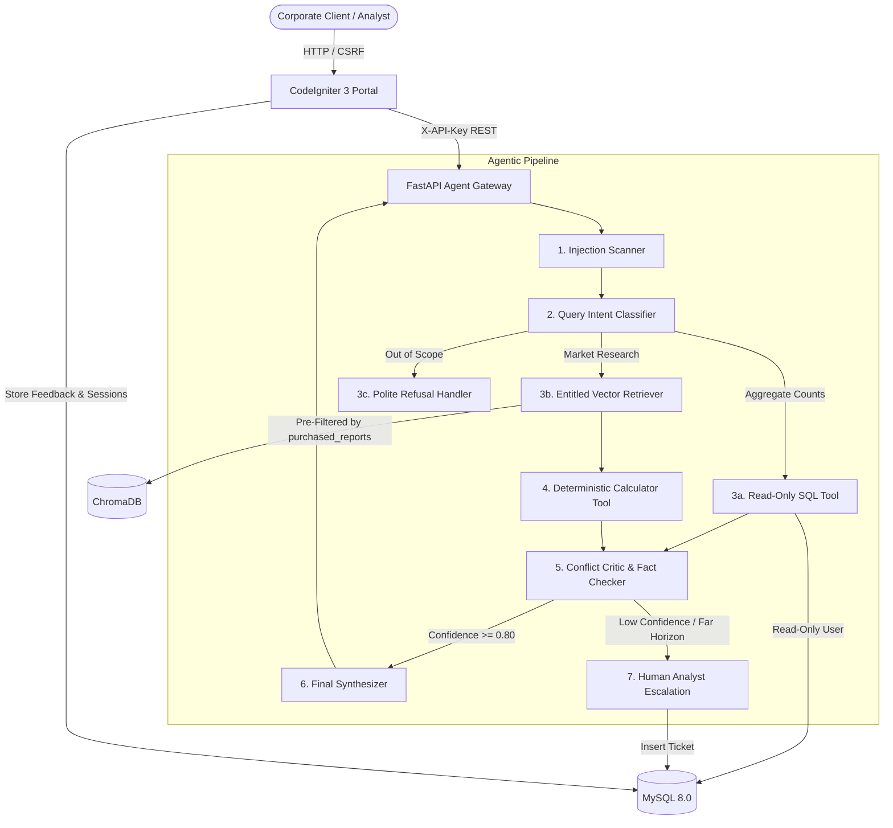

# Project Atlas: Report Copilot

Report Copilot is an enterprise agentic RAG system built for Cognitive Market Research and Consulting. It integrates into a legacy CodeIgniter 3 portal, allowing corporate clients to query syndicated market research reports safely, accurately, and with full entitlement isolation.

---

## 1. Quick Start Guide (Under 10 Minutes)

### Prerequisites
- Docker and Docker Compose installed.

### Launch with Docker Compose
```bash
# 1. Clone the repository
git clone <repo-url>
cd "Project Atlas"

# 2. Copy the environment configuration
cp .env.example .env

# 3. Start all services (MySQL 8, ChromaDB, FastAPI Backend, CodeIgniter 3)
docker compose up --build
```

### Access Endpoints
- **CodeIgniter 3 Chat Portal**: [http://localhost:8080](http://localhost:8080)
- **FastAPI Interactive Docs**: [http://localhost:8000/docs](http://localhost:8000/docs)
- **Health Check**: [http://localhost:8000/health](http://localhost:8000/health)

---

## 2. Local Python Development (Without Docker)

You can also run and evaluate the Python service directly on Windows, macOS, or Linux using Python 3.10+:

```bash
# 1. Install dependencies
pip install -r backend/requirements.txt

# 2. Ingest reports into local ChromaDB
python -m backend.app.services.ingest

# 3. Run the automated 25-question evaluation suite
python -m backend.tests.eval_harness

# 4. Start the FastAPI development server
uvicorn backend.app.main:app --reload --port 8000
```

*Note*: If MySQL is not running locally, the system automatically falls back to a built-in SQLite database seeded with the identical schema and data, ensuring zero configuration crashes.

---

## 3. Architecture Overview



---

## 4. Design Decisions & Trade-Offs

### 1. Pre-LLM Entitlement Filtering vs Post-Retrieval Prompt Filtering
- **Decision**: Filter chunks strictly at the vector database query layer (`where={"report_id": {"$in": allowed_reports}}`).
- **Rationale**: Relying on the LLM to ignore unpurchased text in prompt context frequently leaks figures via indirect prompt injection or hallucination. Pre-filtering ensures unpurchased text physically never reaches the model context.
- **Trade-off**: Requires an additional metadata lookup in MySQL before vector queries, adding ~2ms of latency.

### 2. Deterministic Math Engine vs LLM Calculation
- **Decision**: Execute CAGR and regional projections via a dedicated Python calculator tool.
- **Rationale**: Language models frequently make arithmetic rounding errors over multi-year compounding formulas ($V_{end} = V_{start} \times (1 + r)^n$). Our calculator enforces deterministic math, outputs exact formulas, documents assumptions, and labels the result as a `derived_estimate`.
- **Trade-off**: Requires query intent classification to map requests to the calculator tool.

### 3. Preserving Conflicts vs Averaging
- **Decision**: When two sources report different values (e.g. R-101 at $4.21B vs R-102 at $3.87B for 2024), both values are displayed alongside their scope notes in a dedicated `conflicts[]` JSON structure.
- **Rationale**: In professional syndicated research, averaging two distinct methodology scopes is an unacceptable analytical error.
- **Trade-off**: Requires custom UI cards in the portal to display multi-source discrepancies cleanly.

### 4. Dual User MySQL Security Model
- **Decision**: Configure two distinct database users:
  1. `atlas_app`: Full access for CodeIgniter 3 sessions, chat logs, feedback, and escalation tickets.
  2. `atlas_readonly`: Strictly `SELECT` access on `reports` and `market_metrics` only. The `clients` and `security_audit` tables are explicitly restricted.
- **Rationale**: Even if a natural language SQL query escapes agent-level regex filters, the database engine physically rejects write operations or client email queries.

---

## 5. Directory Structure
```text
Project Atlas/
├── .env.example                       # Environment configuration template
├── docker-compose.yml                 # Multi-container orchestration
├── README.md                          # Documentation and setup guide
├── EVALUATION_REPORT.md               # 25-question test harness results
├── ONE_PAGE_NOTE.md                   # "What I would do with one more week"
├── docs/
│   └── DEMO_SCRIPT.md                 # 3-5 minute demo walkthrough script
├── backend/                           # FastAPI service
│   ├── Dockerfile
│   ├── requirements.txt
│   ├── app/
│   │   ├── main.py                    # REST API endpoints
│   │   ├── config.py                  # Pydantic configuration
│   │   ├── models/api.py              # Typed contracts
│   │   ├── database/                  # MySQL & ChromaDB managers
│   │   ├── guardrails/                # Prompt injection & SQL guards
│   │   ├── tools/                     # Calculator & SQL tools
│   │   ├── agents/agent_engine.py     # Agentic state pipeline
│   │   └── services/ingest.py         # Report ingestion service
│   └── tests/
│       ├── test_agent.py              # Unit tests
│       └── eval_harness.py            # 25-question test runner
├── data/
│   ├── reports/                       # 6 synthetic reports (including Page 14 trap)
│   └── seed_sql/                      # MySQL schema and seeds
└── frontend/                          # CodeIgniter 3 legacy portal
    ├── Dockerfile
    └── application/
        ├── controllers/Copilot.php    # Chat controller & client switcher
        ├── libraries/Python_service.php # cURL client with timeouts & fallbacks
        ├── views/copilot/chat.php     # Responsive UI with XSS escaping
        └── config/                    # CI3 configurations (CSRF enabled)
```

---

## 6. Verification and Testing

To run the complete automated test suite:
```bash
python -m backend.tests.test_agent
python -m backend.tests.eval_harness
```
Result: **25/25 tests passed (100.0%)**, covering conflicts, derived estimates, entitlement isolation, prompt injection defense, SQL write protection, and horizon escalations.
